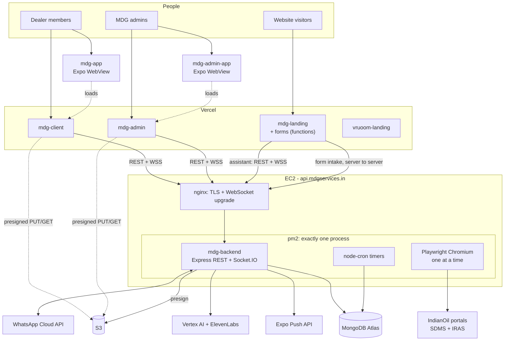
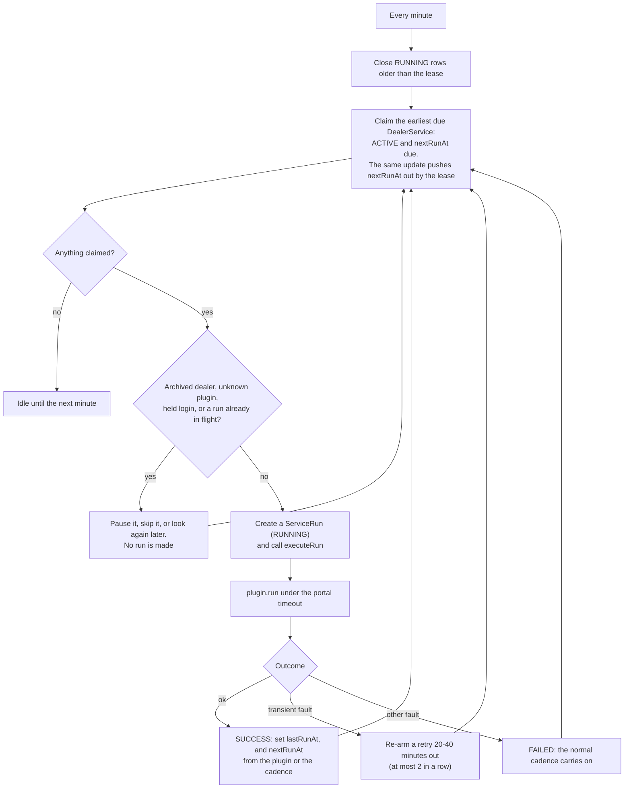
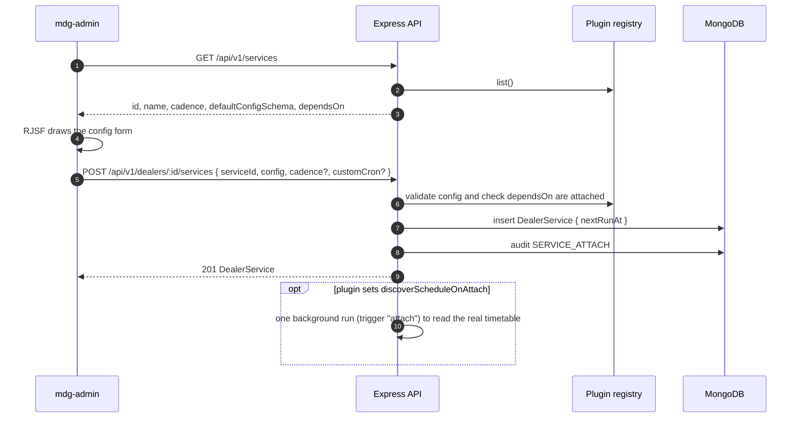
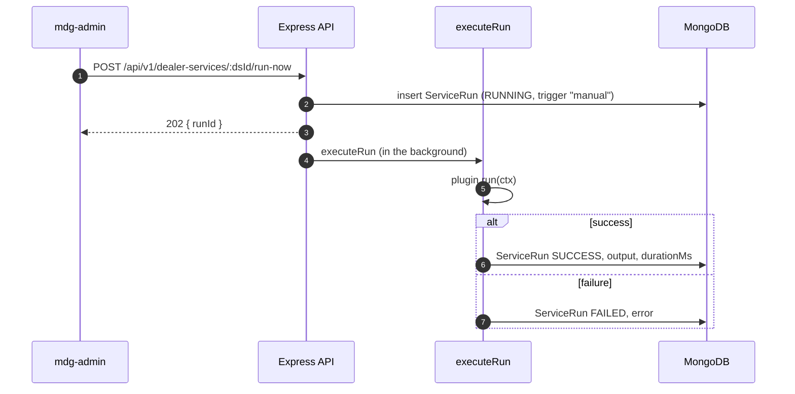

# MDG Services - Architecture

As of 15 October 2026. This is the one architecture document for the whole system: what runs where, and how the parts talk to each other. It does not repeat decisions. Those live in `docs/ADR/` (start at `docs/ADR/README.md`), and the known weak spots live in `LIMITATIONS.md`.

"MDG Services" is the company. "Dealer Kavach" is the app its petrol-pump dealers use.

## 1. What runs where

Seven repos sit side by side in this workspace, each its own Git repo. The shared package lives in this meta repo.

| Repo             | What it is                                                                                                  | Where it runs                                                                                                      |
| ---------------- | ----------------------------------------------------------------------------------------------------------- | ------------------------------------------------------------------------------------------------------------------ |
| `mdg-backend`    | Node 20, Express, Socket.IO, Mongoose, Playwright. The one API, the scheduler and the portal robots.        | EC2 t3.small (2 vCPU, 1,905 MB RAM, 2 GB swap) at `api.mdgservices.in`, behind nginx, as one pm2 process           |
| `mdg-admin`      | React + Vite. The support inbox, dealer management and every other admin screen.                            | Vercel, `admin.mdgservices.in`                                                                                     |
| `mdg-client`     | React + Vite, built for phones. The dealer's app: one chat, plus settings.                                  | Vercel, `client.mdgservices.in`                                                                                    |
| `mdg-app`        | Expo shell that loads `mdg-client` in a WebView and bridges push tokens and taps.                           | Google Play, as "Dealer Kavach"                                                                                    |
| `mdg-admin-app`  | The same shell around `mdg-admin`.                                                                          | Google Play, internal testing (staff only)                                                                         |
| `mdg-landing`    | The marketing site, the voice and chat assistant, the film pages, and the website forms (Vercel functions). | Vercel, `mdgservices.in`                                                                                           |
| `vruoom-landing` | The parent company's site. Static; no backend.                                                              | Vercel, `vruoom.com`                                                                                               |
| `shared/`        | `@dk/shared`: TypeScript types and Zod schemas. The canonical copy.                                         | Not deployed. Vendored (copied) into `mdg-backend/shared`, `mdg-admin/shared` and `mdg-client/shared`, so 4 copies |

`mdg-demo/` (Remotion tutorial videos, tracked in this repo) and `marketing/` (films and the leave-behind pamphlet, in the workspace folder but not in git) are not part of the running system.

Notes:

- nginx ends TLS and upgrades the Socket.IO connection (WSS) on the same origin as REST.
- Browsers send files to S3 and fetch them back directly through short-lived presigned URLs. The bytes never pass through the backend.
- The backend runs as **one** pm2 process on purpose. A second one is a second scheduler: duplicate runs, and two logins at once on the same dealer account. `mdg-backend/ecosystem.config.cjs` pins it.
- Pushing to `main` on `mdg-admin` or `mdg-client` is a production deploy on Vercel. The backend is deployed by `bash deploy.sh` on the box; see [mdg-backend/README.md → Deploy](mdg-backend/README.md#deploy).
- Every `@dk/shared` change must be copied byte for byte into all 4 copies. The apps import their own vendored copy, so a change made only in `shared/` reaches nobody. ADR 0021 has the reason and the check.
- `mdg-app`, `mdg-admin-app`, `mdg-landing` and `vruoom-landing` do not use `@dk/shared`. The landing site copies the assistant's API types by hand.

## 2. The backend

One Node process does four jobs: it serves REST under `/api/v1` (and `GET /health`), serves Socket.IO on the same port (4000 by default), runs the node-cron timers, and drives the portal robots. Data is in MongoDB Atlas (Mongoose, 63 models); files are in S3.

Boot, in order (`src/index.ts`): connect Mongo, load the plugin registry, start the scheduler if `SCHEDULER_ENABLED` is true, attach Socket.IO (plus the landing assistant's `/assist-call` namespace), open the port. The idempotent boot seeds (catalogs, defaults) run after the port opens.

| Folder              | What is in it                                                                                            |
| ------------------- | -------------------------------------------------------------------------------------------------------- |
| `routes/v1`         | About 50 router files, all mounted in `routes/v1/index.ts`                                               |
| `models`            | The 63 Mongoose models (section 13)                                                                      |
| `services`          | The 9 service plugins, plus helper folders that are not plugins (section 3)                              |
| `scheduler`         | The minute tick and the other timers                                                                     |
| `automation`        | The portal robots: `sdms/`, `iras/`, the browser budget, the report-card renderer                        |
| `assist`            | The landing assistant and the AI first line (`assist/firstline`)                                         |
| `assurance`         | The check every daily report passes before a dealer can see it (ADR 0014)                                |
| `realtime`          | The Socket.IO server and the dealer-safe serializers                                                     |
| `whatsapp`, `films` | The WhatsApp sender and webhook intake; film-view analytics                                              |
| `lib`               | Run execution (`lib/runs`), push (`lib/push`), S3 storage (`lib/storage`), sealed secrets (`lib/crypto`) |
| `mdg-backend/ocr`   | Python sidecars: the SDMS login-captcha solver and the pump-slip reader                                  |

Things that are easy to get wrong:

- **Public routers are mounted high.** The assistant, films, WhatsApp webhook and website intake have no login. They sit above `dealersOnboardingRouter` in `routes/v1/index.ts`, because that router puts `requireAuth` on everything under it. A public router mounted below it answers 401 to everyone.
- **Uploads.** `POST /uploads` hands out a presigned S3 PUT per scope (chat file, avatar, Kavach proof, document ask, slip photo, staff photo, density register photo). The ceiling is 25 MB and a signed URL lives 15 minutes by default. The database keeps only the storage key; responses carry a freshly signed URL.
- **Audit.** Changes append an `AuditLog` row through `auditFromReq` (requests) or `writeAudit` (background jobs). See ADR 0020 and `docs/specs/audit-logging.md`.
- **Outside services.** Google Vertex AI (Gemini) for the AI first line, the assistant and the slip reader; ElevenLabs for Hindi speech and live captions; Expo for push; Meta for WhatsApp.

## 3. The scheduler and the service plugins

### The idea

The scheduler pulls work; nothing pushes work to it. Each minute it asks Mongo for work that is due and claims it in the same update that moves the due time forward. Nothing lives only in memory, so a restart loses no work. A claim is a lease: if the process dies mid-run, the lease runs out and the next tick picks the work up again. ADR 0003 has the reasoning.

What to know about it (`mdg-backend/src/scheduler/index.ts`, `src/lib/runs/executeRun.ts`):

- **Serial.** A tick runs the due items one after another. Browser runs are also capped by `BROWSER_MAX_CONCURRENCY=1` (section 4). A tick that is still running makes the next one skip, unless it has outlived the lease, in which case a new tick starts and logs an error.
- **Lease** = 2 x `SDMS_RUN_TIMEOUT_MS` + 15 minutes. At the default 7-minute SDMS timeout that is 29 minutes. Timeouts are per portal: IRAS 300 s, SDMS 420 s.
- **Stale runs.** A row left RUNNING past the lease (a crash, a deploy mid-run) is closed by the reaper at the start of every tick.
- **Retries.** A transient failure re-arms a retry 20 to 40 minutes later, at most twice in a row. After that the normal cadence carries on.
- **Self-scheduling.** A plugin can return its own `nextRunAt`. Its `defaultCustomCron` is the floor it falls back to if a run fails before it can say.
- **Held logins.** An SDMS service whose outlet has no saved password, or whose saved password the portal has refused, is not run at all. It stays ACTIVE and is looked at again every 15 minutes. "Run now" from an admin skips this hold.
- **ON_DEMAND is not PAUSED.** `ON_DEMAND` is a cadence: no timer, admin-triggered. `PAUSED` is a status: the attachment is switched off.
- **Laptops.** `SCHEDULER_ENABLED=false` starts the same process with no timers at all (no scheduled runs, Kavach passes, sweeps or admin alerts).

The other timers start from the same place (`startScheduler`), so they exist only where the scheduler does. Times are IST (`KAVACH_TZ`) where noted.

| Timer             | Default          | What it does                                                                                                                                                                |
| ----------------- | ---------------- | --------------------------------------------------------------------------------------------------------------------------------------------------------------------------- |
| Service tick      | every minute     | The pull described above                                                                                                                                                    |
| Kavach refresh    | 00:20 IST, daily | Re-derives each dealer's Kavach statuses. Document-ask expiry and paper-validity reminders ride this pass                                                                   |
| Kavach digest     | hourly, IST      | Delivers each dealer's daily Kavach list to those whose chosen hour it is, and who an admin has switched on                                                                 |
| Morning asks      | 09:00 IST, daily | Asks in the chat for yesterday's density register page and any open request the chat was never told about (ADR 0019). Catches up shortly after a restart if nine has passed |
| Ticket sweep      | every minute     | Returns an ASSIGNED ticket to the unassigned pool, and flags it, once the client has waited 20 minutes and the admin has held it that long                                  |
| Assistant sweep   | every 5 minutes  | Closes assistant conversations the visitor walked away from; deletes call audio past retention                                                                              |
| Admin alert sweep | every 2 minutes  | Section 9                                                                                                                                                                   |

### Service plugins

A service is a recurring job attached to a dealer. Each one is a folder in `mdg-backend/src/services/` whose `index.ts` has a default export that satisfies the `ServicePlugin` contract in `@dk/shared` (ADR 0002). Adding one means adding the folder. No registry edit, no change to the admin. Steps are in `docs/ADDING_A_SERVICE.md`. Plugins run inside the API process. They are first-party code and are not sandboxed.

At boot, `services/registry.ts` reads the services folder (in production, the compiled `dist/services`) and:

1. skips names that start with `_`, and folders with no `index`;
2. skips an `index` with no default export, with a warning;
3. checks the export against the contract, and fails the boot if it is wrong (`id` must equal the folder name, a `defaultCustomCron` must be a runnable cron);
4. compiles `defaultConfigSchema` (JSON Schema) with Ajv, which validates config at attach time and drives the admin's form.

Folders such as `adminAlerts/`, `tickets/`, `festival/` and `websiteIntake/` have an `index` but no default export, and `chatAsks/`, `documents/`, `kavach/` and the camel-case twins of the plugins (`ttDensity/`, `irasData/` ...) have none at all. They are helpers, not plugins. After a clean deploy the boot log line "Service registry initialised" reads `count: 9`.

| Plugin id               | Where its data comes from                            | Default rhythm                                                               |
| ----------------------- | ---------------------------------------------------- | ---------------------------------------------------------------------------- |
| `iras-shift-data`       | IRAS portal                                          | Daily, anchored on the dealer's shift time. Fills the Data Vault             |
| `dsr-report`            | The Data Vault + inspection reports                  | Daily. Needs `iras-shift-data` and `inspection-reports` attached             |
| `inspection-reports`    | SDMS / e-Mitra                                       | Weekly                                                                       |
| `credit-dod-monitoring` | SDMS (credit page, PAD ledger)                       | Daily. An admin reviews and shares the card                                  |
| `tt-density`            | SDMS (tanker invoices)                               | Daily at 07:35 IST                                                           |
| `water-ingress-testing` | SDMS (writes the observation back)                   | Every two hours, then steers itself off the portal's slot grid               |
| `ro-supply-status`      | SDMS                                                 | No timer. Rides the water-ingress run's login. Needs `water-ingress-testing` |
| `load-planner`          | Data the system already holds (DSR, tanks, invoices) | Daily at 09:45 IST. Needs `dsr-report`                                       |
| `custom-request`        | Nothing                                              | On demand only. A placeholder for one-off work                               |

Each plugin's README, where it has one, sits in its folder: `credit-dod-monitoring`, `custom-request`, `inspection-reports`, `iras-shift-data`, `load-planner`, `tt-density`, `water-ingress-testing`. TT Density's decision is ADR 0010.

Not everything stateful is a plugin. The **Kavach programme** (ADR 0006, 0011; spec `docs/specs/kavach-engine.md`), **staff points** (ADR 0007), **document asks** (ADR 0019), the **AI first line**, the **landing assistant** (ADR 0009) and the **slip reader** (ADR 0012) have their own models, routes and, where needed, timers.

### Attach and run now

A manual run does not touch the service's `nextRunAt` timetable or its retry count; those belong to the scheduler.

## 4. Portal automation

IndianOil has no API for what dealers need, so the robots use the portals the way a person would, in headless Chromium (Playwright).

- **Two portals.** SDMS / e-Mitra at `utkarsh.indianoil.co.in` (credit, inspections, tanker invoices, water ingress, supply status) and IRAS at `iras.iocliras.in` (shift data).
- **Logins.** Each outlet's portal ID and password is stored encrypted (AES-256-GCM, `lib/crypto/secretBox.ts`). The SDMS login question is now a small sum, read from the page text first; the Python OCR sidecar is the fallback, and also reads IRAS captchas. On SDMS, two logins on the same IndianOil user never overlap, and a quiet gap is kept between them.
- **One browser at a time.** `BROWSER_MAX_CONCURRENCY` (default 1) caps Chromium across SDMS captures, IRAS collections and report-card renders alike. This is a memory limit, not a portal limit. A render an admin is waiting on gives up after 45 s with "busy, try again". A script started by hand over SSH launches its own browser, which this counter cannot see.
- **The Data Vault.** `iras-shift-data` collects once; everything else reads the stored snapshot (`services/irasData`) and never scrapes again. Admins can correct any collected field by hand, and the correction overlays the snapshot (`docs/product/iras-data-editing.md`).
- **From a portal to a dealer's phone.** A run stores a snapshot and renders a card (a PNG drawn in the same Chromium). Daily sales reports pass the assurance layer first: in production `ASSURANCE_MODE=ENFORCE`, so a report that fails its checks is held and raises a `report_held` alert (ADR 0014). An admin shares the card, or an automation posts it. `postToDealer` then writes it into the right chat as a picture message: every owner's own chat, the manager group, or both.
- **Fragility.** Portals change, captchas change, accounts can be locked. `LIMITATIONS.md`, "Portal scraping (SDMS / IRAS)", is the honest list.

## 5. Chat, tickets and the AI first line

**Threads.** Every dealer member is the primary member of exactly one `Conversation` (a unique index on `userId`). An owner's thread has `kind: 'support'`: that owner and the MDG admin pool. The manager's thread has `kind: 'manager'`: the manager, every owner of the dealer, and the admin pool. `dealerId` groups threads under an outlet; the admin inbox lists threads per member, grouped by outlet. A member can read only threads they are a participant in.

**Lifecycle.** A thread is `OPEN`, `ASSIGNED` or `RESOLVED`. A client message on a resolved thread reopens it as a new unassigned ticket. Triage fields are admin-only and are stripped from everything a dealer receives: `priority` (low, normal, high, urgent), `category` (general, sales, compliance, billing, technical, onboarding), the assignee and the reply clock. Changes to them are audited. The clock starts at the client's oldest unanswered message: yellow at 90 minutes, red at 180. An assigned ticket the client has waited 20 minutes on goes back to the pool (ticket sweep), once the admin has held it that long too. Details: `docs/specs/ticket-lifecycle-and-reply-sla.md`.

**The thread is the ticket.** For work a person does by hand there is no separate CRM: the conversation holds the history, and triage is a few fields on it (ADR 0004). The separate `Ticket` record below exists only for what the AI hands over (ADR 0017).

**Resolving needs a service log.** `POST /conversations/:id/resolve` requires a `serviceId` from the catalog (or `other` plus a name) and notes. It writes a `ServiceLog` and only then sets `RESOLVED`. That keeps each dealer's "services provided" history true, and the whole outlet shares it. An admin can also log work that is not tied to a conversation (`POST /service-logs`). Resolving does not certify any Kavach task: a person or an automation does that (ADR 0011).

**Requests live in the chat.** What MDG needs from a dealer is a message with an `ask` block (a paper, the density register page, a Kavach photo). The dealer answers in the same chat, and the answer links back to the ask (`answersAsk`). An admin marks it received or sends it back (ADR 0019). Reports are pictures and files in the chat. There are no Records and no Reports shelf (ADR 0018).

**The AI first line** (ADR 0013, 0017) answers dealer questions before a person does. Production runs `AI_FIRSTLINE_ENABLED=true` with `AI_FIRSTLINE_ENGINE=brief`.

- The `brief` engine builds a briefing of what MDG holds on the outlet (papers, DSR status, density, Kavach, staff, services, tickets) and writes the reply in one model call. Every figure in the reply must trace back to a fact in the briefing, or the reply is refused. The older `router` engine is still selectable by env, and a super-admin switch in the database turns the whole feature off with no deploy.
- The dealer's id always comes from the conversation, never from the model, so one outlet cannot be pointed at another.
- What a reply may say depends on who can read the thread. An owner's chat is cleared for the owner; the manager group is cleared for the manager, so credit and ownership details are never briefed there.
- When it cannot or should not answer, it opens a **Ticket**: its own record, one open per thread, closed only by an admin writing a resolution note. The ticket shows on the admin's Tickets page, raises a `ticket_open` alert, and shows the dealer one quiet status line under their message (ADR 0017).
- Every turn is logged (`AiTurn`) and reviewed on the admin's AI answers page. A posted message can be neither edited nor recalled, so the checks run before it is posted (ADR 0013, 0014).

## 6. The apps

**Dealer app** (`mdg-client`, wrapped by `mdg-app`). The chat list is home, always. There is no bottom bar. Settings sits behind the menu on the chat list and leads to profile, account, team, Services and the staff-points roster. The old pages `/asks`, `/documents`, `/density` and `/kavach` now just open the chat. The app is bilingual, Hindi by default (ADR 0008). Sign-up ("Register your pump") posts to the website's intake (section 11). The WebView shell hands the Expo push token to the app across a small bridge and turns a tapped push into a route (`mdg-app/README.md`).

**Admin** (`mdg-admin`, wrapped by `mdg-admin-app`). The inbox is the centre: threads, replies, tickets, open requests, resolve. Around it: Tickets, Alerts, Today (a triage queue and per-dealer board), AI answers, dealers, Kavach, documents, the Data Vault and DSR vault, Ledger Watch, assurance, the assistant, films, WhatsApp, grievances, registrations, services and runs, an activity trail, users, and the calendars (bank holidays, depot closures, festival band). Super-admin pages sit behind `requireSuperAdmin`. The admin is English only and usable on a phone: `mdg-admin/docs/MOBILE.md`.

Both apps import `@dk/shared` for types and schemas, never backend code. Design rules: `docs/STYLE_GUIDE_V2.md`.

## 7. Realtime

Socket.IO on the API's origin. The JWT goes in the handshake (`auth.token`) and is checked before any room is joined. A dealer's socket gets the same session and archived-dealer checks as REST.

| Room                | Who is in it                                                                   | Used for                                                                                 |
| ------------------- | ------------------------------------------------------------------------------ | ---------------------------------------------------------------------------------------- |
| `inbox:admins`      | Every admin socket                                                             | Inbox-wide updates, ticket and alert changes                                             |
| `user:<userId>`     | One dealer member                                                              | That member's thread updates, even when the chat screen is not open                      |
| `dealer:<dealerId>` | All of one outlet's members                                                    | Outlet-wide events (a document ask changing)                                             |
| `conversation:<id>` | Anyone who joined the thread (admins: any; members: threads they take part in) | `message:new`, `message:reaction`, `conversation:updated`, `typing`, `delivered`, `read` |

Events the server sends: `message:new`, `message:reaction`, `conversation:updated`, `document-ask:updated`, `alerts:changed`, `tickets:changed`, `typing`, `delivered`, `read`. Admins and dealers get **different payloads** for the same change: the admin gets the full conversation, the dealer gets an allow-list copy with the triage fields removed (`conversationForDealer`). The landing assistant's live call uses its own namespace, `/assist-call`, on the same server.

## 8. Push

`lib/push/expoPush.ts` finds the target users' `Device` rows (one per installed app, keyed by its Expo token and registered through `POST/DELETE /api/v1/devices`) and sends through the Expo Push API. It is best effort: failures are logged, dead tokens are deleted, and `PUSH_ENABLED=false` makes every send a no-op.

| Event                                                           | Who is pushed                                                    |
| --------------------------------------------------------------- | ---------------------------------------------------------------- |
| An admin reply, or an AI first-line reply, in a thread          | The thread's dealer members who have it unread                   |
| A dealer member writes in a thread                              | The other dealer members of the thread, and every active admin   |
| A thread is resolved                                            | The members of that thread                                       |
| A report or card is shared; an ask, reminder or nudge is posted | The members it is addressed to                                   |
| An admin alert is raised (section 9)                            | Every active admin, or super-admins only for the kinds marked so |
| A visitor asks the assistant for a call back                    | Super-admins                                                     |

A push carries a `path` that the WebView shell opens: `/chat/<id>` for a dealer, `/inbox?c=<id>` for an admin's message alert.

## 9. Admin alerts

Every two minutes the server checks for anything that needs a person (ADR 0016). A new problem goes on the **Alerts** list in the admin and is pushed to every active admin; it clears itself when the problem is fixed. Kinds include portal logins refused, services failed, late or stopped, chats waiting, papers to review or expiring, Kavach proof to verify, reports held, supply blocked, ledger charges, WhatsApp replies, open tickets, grievances, new registrations, and server restarts. Some events raise an alert straight away instead of waiting for the sweep. A heartbeat in Mongo is how a restart is noticed. WhatsApp replies, grievances, registrations and the two server-health kinds are super-admin only; the rest go to every admin.

## 10. WhatsApp

WhatsApp is not a support channel: dealers talk to MDG inside the app. The Cloud API number is used for two things.

- **Outbound promotion.** The `whatsapp:film` script in `mdg-backend` sends the approved film-intro template once to each person on a list, with a film link of their own. It checks the stop list immediately before every send, claims a ledger row before calling Meta so nobody is sent the same campaign twice, and stops after a run of failures.
- **Inbound.** `POST /api/v1/whatsapp` is Meta's webhook: delivery reports, replies and taps on "Stop promotions". It is public, gated by Meta's `X-Hub-Signature-256` signature, and answers 404 when the secrets are not set. A reply raises a `whatsapp_reply` alert; super-admins read replies on the admin's WhatsApp page.

## 11. The website and how it reaches the backend

`mdg-landing` is a Vite site with a few Vercel functions (`api/`). Three things connect it to the backend.

- **The assistant.** The visitor's browser talks straight to `/api/v1/assist` and the `/assist-call` socket on `api.mdgservices.in`, with no login. The backend allows the site's origin, session tokens, rate buckets and a block list stand in for a login. It answers only from a fixed knowledge base, records calls, and hands the lead to super-admins (ADR 0009; run steps in `docs/ASSIST_RUNBOOK.md`). The assistant can also take a grievance.
- **Forms.** For a grievance or a "Register your pump" form, the Vercel function checks the form, sends the emails, and hands the form to `POST /api/v1/website/grievances` or `/enrolments`. Only the site's own server calls these: a shared secret in the `Authorization` header stands in for a login, and without a secret the router answers 503. Super-admins read them on the Grievances and Registrations pages, and each raises an alert. The homepage call-back form is email only.
- **Films.** The film pages send view beacons to `/api/v1/films` for the analytics a super-admin reads (ADR 0015).

The site shows outcomes only, never method, and no internal screens.

## 12. Security and roles

- **Roles.** `admin`, `dealer-owner` and `dealer-staff`. A manager is a `dealer-staff` with the title "Manager". On top of `admin` there is a **super-admin** flag (`User.isSuperAdmin`), re-read from the database on every request, so a promotion or a suspension applies on the next call. `requireSuperAdmin` guards the routers that hold other people's data or change behaviour for everyone (assistant, films, WhatsApp, grievances, the user console, Kavach and document catalogs, the AI switch, calendars).
- **Tokens.** A signed JWT (HS256) goes in `Authorization: Bearer ...` and in the socket handshake. Admin tokens last 12 hours (`JWT_EXPIRES_IN`). Dealer tokens last 365 days (`JWT_DEALER_EXPIRES_IN`), because a login screen is where a dealer stops using the app. Once a token is an hour old, the next response carries a fresh one in `X-Refreshed-Token` and the client swaps it in.
- **Sessions.** A dealer account has one active session: signing in on another device ends the first. Suspending a user, or archiving a dealer, cuts off already-issued tokens on the next REST request. A socket is checked when it connects.
- **Scoping.** Every dealer-facing read and write is limited by the token's `dealerId`, never one the caller names. A member reads only their own threads. The dealer-side payloads are allow-lists.
- **Authorisation is by route.** Each route names its roles (`requireRole('admin')`); there is no field-level policy engine. Credit, ledger and invoice data is admin-only.
- **Files.** Presigned URLs are short-lived and per object; the backend decides which keys a caller may presign or read.
- **Secrets.** Portal passwords are sealed with AES-256-GCM. An admin's "reveal" is rate limited, and it is refused if its audit row cannot be written. Login is rate limited too.

## 13. Data

MongoDB, Mongoose, 63 models. Index definitions live in the model files. The groups:

| Group                  | Models                                                                                                                                                                                                                                                                                               |
| ---------------------- | ---------------------------------------------------------------------------------------------------------------------------------------------------------------------------------------------------------------------------------------------------------------------------------------------------- |
| People and outlets     | `Dealer`, `User`, `Admin` (older admin store), `Device`, `Employee`, `EmployeeLeave`                                                                                                                                                                                                                 |
| Chat and tickets       | `Conversation`, `Message`, `Ticket`, `ServiceLog`, `AiTurn`, `AiSetting`, `AssuranceRemark`                                                                                                                                                                                                          |
| Services and audit     | `DealerService`, `ServiceRun`, `AuditLog`, `Counter`                                                                                                                                                                                                                                                 |
| Vault and reports      | `IrasDataSnapshot`, `IrasDataCorrection`, `IrasDayVerification`, `DsrReport`, `DsrLedgerEntry`, `DsrManualReceipt`, `SlipRead`, `InspectionReportSnapshot`, `RoSupplyStatusSnapshot`, `CreditDodSnapshot`, `CreditPad*`, `Ledger*`, `LoadPlan`, `TtInvoice`, `TtDensityDayLog`, `WaterIngressDayLog` |
| Compliance and asks    | `Kavach*`, `DealerKavachList`, `DocumentAsk`, `DocumentKind`, `StaffWorkItem`, `StaffPoint*`, `DealerWorkList`                                                                                                                                                                                       |
| Calendars and settings | `BankHoliday`, `DepotHoliday`, `FestivalSetting`                                                                                                                                                                                                                                                     |
| Website and outreach   | `AssistSession`, `AssistBlock`, `AssistUsageDay`, `Grievance`, `Enrolment`, `FilmView`, `FilmShareLink`, `WhatsAppMessage`, `WhatsAppSend`, `WhatsAppOptOut`                                                                                                                                         |
| Operations             | `AdminAlert`, `ServerHeartbeat`                                                                                                                                                                                                                                                                      |

## 14. Where to read next

`docs/ADR/README.md` for why things are built this way. `LIMITATIONS.md` for what is known to be weak. `docs/API_CONTRACT.md` for the API. `docs/ADDING_A_SERVICE.md` to add a service. `docs/ASSIST_RUNBOOK.md` to run the landing assistant. `docs/STYLE_GUIDE_V2.md` for how a screen should look. The Deploy section of [mdg-backend/README.md](mdg-backend/README.md#deploy) to ship the backend. Each service folder under `mdg-backend/src/services/` has its own README where there is one.
